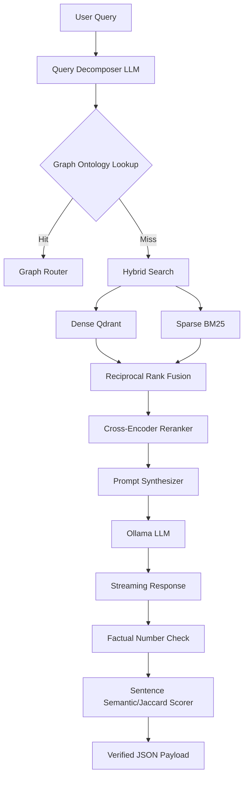

# RBI Regulatory Circular RAG Pipeline (v2) - Pipeline Explainer

## 1. Mathematical Definitions

### BM25Okapi Scoring
The BM25 formula scores the relevance of a document $D$ to a query $Q$:
$$ \text{Score}(D, Q) = \sum_{i=1}^{n} IDF(q_i) \cdot \frac{f(q_i, D) \cdot (k_1 + 1)}{f(q_i, D) + k_1 \cdot (1 - b + b \cdot \frac{|D|}{\text{avgdl}})} $$

### Qdrant Cosine Similarity
For a query vector $A$ and document vector $B$:
$$ \text{Cosine Similarity} = \frac{A \cdot B}{\|A\| \|B\|} = \frac{\sum_{i=1}^{n} A_i B_i}{\sqrt{\sum_{i=1}^{n} A_i^2} \sqrt{\sum_{i=1}^{n} B_i^2}} $$

### Reciprocal Rank Fusion (RRF)
Combines dense and sparse ranks. Using a smoothing constant $k=60$:
$$ \text{RRF Score}(D) = \frac{1}{k + \text{rank}_{dense}(D)} + \frac{1}{k + \text{rank}_{sparse}(D)} $$

### Jaccard Similarity Index
Used for sentence-level groundedness checks:
$$ J(A, B) = \frac{|A \cap B|}{|A \cup B|} $$

## 2. Architectural Workflows

